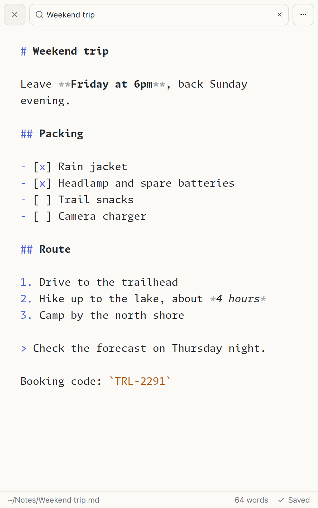
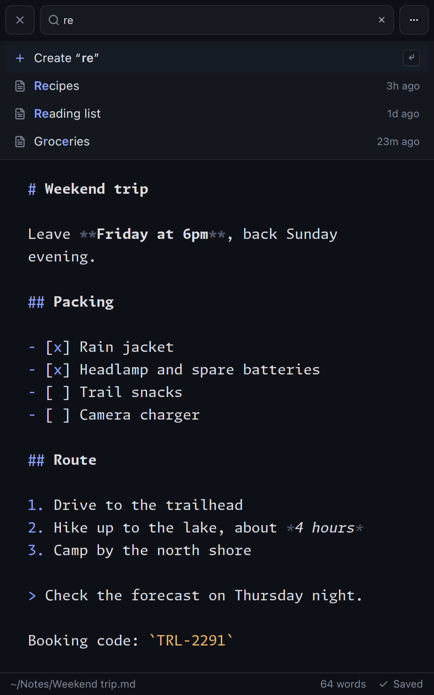

<div align="center">
  
  <h1>Noty</h1>
  <p>A minimal, keyboard-driven note taking app</p>
  <a href="https://github.com/dagimg-dot/noty/releases/latest"></a>
  <a href="https://github.com/dagimg-dot/noty/releases/latest"></a>
  <br><br>
  
  
</div>

Type to find a note, press <kbd>Enter</kbd> to open it, or to create it when nothing matches. Notes are plain Markdown files in a folder you choose, saved as you type. Built with [GPUI](https://www.gpui.rs) for Linux, macOS and Windows.

## Install

Download `noty-x.x.x-linux-<arch>.tar.gz` from the [latest release](https://github.com/dagimg-dot/noty/releases/latest) and extract it into `~/.local`:

```bash
tar -xzf noty-x.x.x-linux-x86_64.tar.gz -C ~/.local --strip-components=1
```

To build from source you need Rust 1.92 or newer and, on Linux, a Vulkan driver plus the fontconfig, freetype, libxcb and libxkbcommon development files. Then run `make install`, or `make run` for a development build.

## Shortcuts

| Keys | Action |
| --- | --- |
| <kbd>Ctrl</kbd>+<kbd>P</kbd>, <kbd>Alt</kbd>+<kbd>S</kbd> or <kbd>Esc</kbd> | Switch between search and the editor |
| <kbd>↑</kbd> <kbd>↓</kbd> or <kbd>Ctrl</kbd>+<kbd>J</kbd> <kbd>Ctrl</kbd>+<kbd>K</kbd> | Move through the note list |
| <kbd>Enter</kbd> / <kbd>Shift</kbd>+<kbd>Enter</kbd> | Open or create a note / create exactly what you typed |
| <kbd>F2</kbd> / <kbd>Delete</kbd> | Rename / delete a note |
| <kbd>Ctrl</kbd>+<kbd>S</kbd> / <kbd>Ctrl</kbd>+<kbd>Shift</kbd>+<kbd>R</kbd> | Save now / reload from disk |
| <kbd>Alt</kbd>+<kbd>↑</kbd> <kbd>↓</kbd> | Move lines up or down |
| <kbd>Shift</kbd>+<kbd>Alt</kbd>+<kbd>↑</kbd> <kbd>↓</kbd> | Duplicate lines above or below |
| <kbd>Ctrl</kbd>+<kbd>=</kbd> <kbd>-</kbd> <kbd>0</kbd> | Text size |
| <kbd>Alt</kbd>+<kbd>L</kbd> | Toggle line numbers |
| <kbd>Ctrl</kbd>+<kbd>?</kbd> | Show all shortcuts |

On macOS, <kbd>⌘</kbd> replaces <kbd>Ctrl</kbd>, except in <kbd>Ctrl</kbd>+<kbd>J</kbd> and <kbd>Ctrl</kbd>+<kbd>K</kbd>.

## Themes and Settings

Themes, appearance, line numbers and text size are in the <kbd>⋯</kbd> menu. Noty ships with Adwaita, Catppuccin, Nord, Tokyo Night, Vesper and its own Paper and Night themes, adapted from the [Vicinae](https://github.com/vicinaehq/vicinae) collection.

Custom themes use the Vicinae TOML format and go in `~/.local/share/noty/themes` (`~/Library/Application Support/noty/themes` on macOS, `%APPDATA%\noty\themes` on Windows). A theme only needs a few colors:

```toml
[meta]
name = "Mint Paper"
variant = "light"
inherits = "noty-light"

[colors.core]
background = "#f6faf7"
foreground = "#1e2b24"
accent = "#2f8f63"
```

Other settings, such as `notes_dir`, `sorting_method` and `custom_font`, live in `com.dagimg.noty.json` in your config folder. Run `noty --notes-dir DIR` to open another folder once.

## Contributing

See [CONTRIBUTING.md](CONTRIBUTING.md) for the project layout.

## License

GPLv3, see [COPYING](COPYING).
