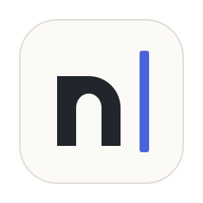

<div align="center">
  
  <h1 align="center">Noty</h1>
  <p align="center">A minimal keyboard driven note taking application</p>
  <p>
  <a href="https://github.com/dagimg-dot/noty/releases/latest">
    
  </a>
  <a href="https://github.com/dagimg-dot/noty/releases/latest">
    
  </a>
  </p>
</div>

<div align="center">
  
  
</div>

## Features

- **Minimal Interface:** Focus on your notes without distractions.
- **Keyboard Driven:** Designed primarily for mouse-free operation.
- **Flatpak:** Easy installation and updates.
- **External change detection:** Automatically reload notes when changed outside the app.
- **Custom font and color scheme:** Choose your preferred font and color scheme.


> [!NOTE]
> This branch is porting Noty from Python/GTK4 to Go with the
> [MyGo](https://github.com/egoist/mygo) framework. It is a work in progress:
> for now it only lists your notes. The Python version is on the `dev` and
> `main` branches.

## Installation

Noty will ship as binary releases (a `.tar.gz` with an install script, a
`.deb` and a `PKGBUILD`) from the [GitHub Releases page](https://github.com/dagimg-dot/noty/releases).

### Building from Source

**Dependencies:**

- Go 1.27.3 or newer (an older `go` downloads it on its own with `GOTOOLCHAIN=auto`, the default)
- GTK 3 and libepoxy at runtime; no C compiler or development packages are needed to build

**Steps:**

```bash
git clone https://github.com/dagimg-dot/noty.git
cd noty
make run      # run with debug logging
make dev      # rebuild and restart on changes
make test     # run the tests
make build    # release binary and Linux packages in build/
```

Development builds use the app ID `com.dagimg.dev.noty`, so their settings
(`~/.config/com.dagimg.dev.noty.json`) are kept apart from a release's
(`~/.config/com.dagimg.noty.json`). Settings from the Python and Flatpak
versions are picked up on first launch.

## Port status

- [x] Settings, compatible with the Python version's file
- [x] Notes directory: scan, create, rename, delete, save, external change detection
- [ ] Main window: search, notes list, editor, toasts
- [ ] Preferences, keyboard shortcuts, about
- [ ] Theme system (TOML themes for the whole app and the editor)
- [ ] Binary release workflow
- [ ] Vim mode

## License

`Noty` is distributed under the terms of the GPLv3 license. See the [COPYING](COPYING) file for details.
